# Recurring Investment Simulator

**How often, and on which day, should a recurring investment buy?**

Say you invest $1,000 every month in an index fund. You still have to decide *how* that money goes in:
all at once on the 1st? $250 every Monday? A little every trading day? Every two weeks on a Friday?

This app answers that using real price history instead of guesswork. It replays **64 different buying
schedules** against a ticker's actual prices and shows which ones would have grown your money the most,
both over one period you pick and across every period in the ticker's history.

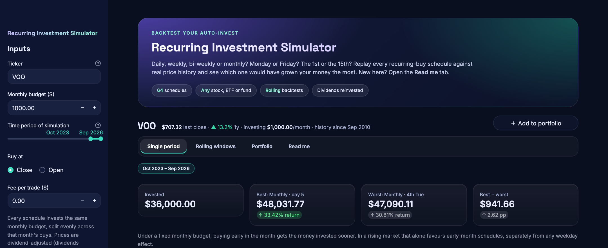

---

## Contents

- [The idea in 30 seconds](#the-idea-in-30-seconds)
- [Quick start](#quick-start)
- [A tour of the app](#a-tour-of-the-app)
  - [1. Sidebar: your inputs](#1-sidebar-your-inputs)
  - [2. Single period tab](#2-single-period-tab)
  - [3. Rolling windows tab](#3-rolling-windows-tab)
  - [4. Portfolio tab](#4-portfolio-tab)
  - [5. Read me tab](#5-read-me-tab)
- [The 64 schedules](#the-64-schedules)
- [How the simulation works](#how-the-simulation-works)
- [What you will usually find](#what-you-will-usually-find)
- [Project layout](#project-layout)
- [Disclaimer](#disclaimer)

---

## The idea in 30 seconds

- Every schedule invests **exactly the same amount each month**. The only thing that differs is *when*
  in the month the money goes in.
- The app buys at real historical prices, reinvests dividends, and values each account at the end.
- You see the **final value and total return** of every schedule, and which ones came out on top.
- Because one period can be luck, the app also repeats the test over **every window** (for example,
  every 24-month stretch) in the ticker's history, to show which schedules win *consistently*.

---

## Quick start

You need Python 3.9 or newer.

```bash
git clone https://github.com/sayantan92sanyal/recurring-investment-simulator.git
cd recurring-investment-simulator
python3 -m venv .venv
.venv/bin/pip install -r requirements.txt
.venv/bin/streamlit run app.py
```

The app opens in your browser at **http://localhost:8501**.

On Windows, use `.venv\Scripts\pip` and `.venv\Scripts\streamlit` instead.

The first time you look up a ticker, its prices are downloaded from Yahoo Finance and saved in the `data/`
folder. After that, the app loads them from disk, so the same inputs always give the same results.

Yahoo Finance sometimes refuses downloads, especially from shared cloud servers. The app retries a
couple of times, and if Yahoo still refuses, it falls back to saved prices shipped in the `seed/` folder
(AAPL, ARKK, GLD, GOOG, MSFT, NVDA, PWB, QQQ, SCHD, SOXL, SOXX, VOO, VTI). When it is using saved prices
that are more than a week old, the app says so.

---

## A tour of the app

The screenshots below use **VOO** (an S&P 500 ETF), **$1,000 a month**, from **Oct 2023 to Sep 2026**.
Your numbers will differ depending on the ticker, the dates and when you download the prices.

### 1. Sidebar: your inputs

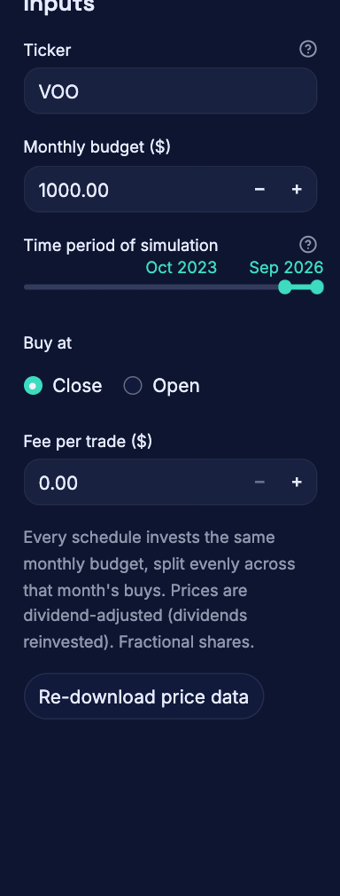

Everything you control is in the sidebar on the left.

| Input | What it does |
|---|---|
| **Ticker** | Any symbol on Yahoo Finance: stocks (AAPL), ETFs (VOO, QQQ) or mutual funds. |
| **Monthly budget** | How much you invest each month. Every schedule gets the same amount. |
| **Time period of simulation** | The months to simulate, in whole months. Used by the Single period and Portfolio tabs. |
| **Buy at** | Buy at the day's **close** price (default) or its **open** price. |
| **Fee per trade** | An optional fixed fee for every buy. Useful for seeing whether buying daily still pays off once each trade costs something. |
| **Re-download price data** | Fetches fresh prices from Yahoo Finance, replacing the saved copy. |

Above the tabs, the **ticker header** shows the last close, the 1-year change, your monthly amount and how
far back the price history goes. The **＋ Add to portfolio** button on the right saves this ticker for the
Portfolio tab.

<br clear="right">

### 2. Single period tab

This tab answers: *"Over the period I picked, how did every schedule do?"*

**Summary tiles.** At the top, four tiles show how much you put in, the best schedule, the worst schedule,
and the gap between them. In the example, buying monthly on the 5th ended at **$48,031.77**, and buying on
the 4th Tuesday of each month ended at **$47,090.11**. Same $36,000 invested, **$941.66** apart.

Below the tiles are four charts. Each chart has a short **"What it shows"** and **"How to read it"** note
above it.

#### Chart 1: Total return of every schedule, by frequency

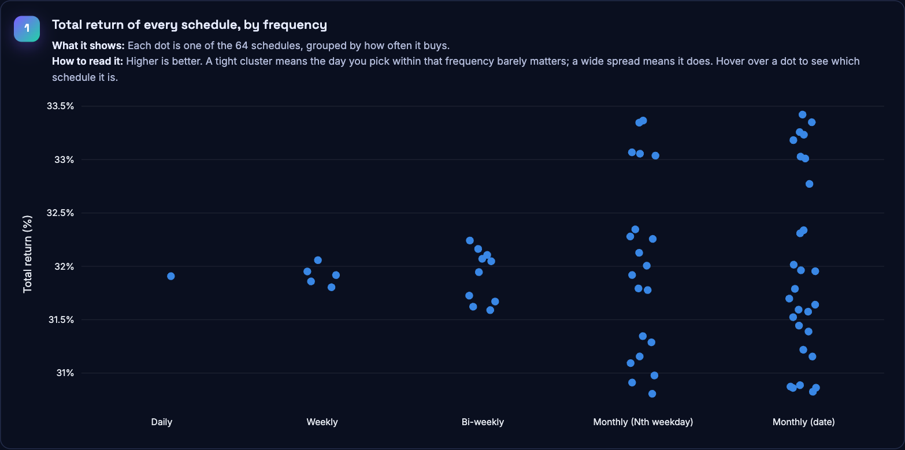

Each dot is one schedule, grouped into columns by how often it buys. **Higher is better.**

- A **tight cluster** means the day you choose barely matters at that frequency.
- A **tall, spread-out column** means the day matters a lot. Here, the monthly schedules range from about
  31% to 33.5%, while Daily and Weekly sit close together near 32%.

Hover over any dot in the app to see which schedule it is.

#### Chart 2: Total return by frequency and weekday (the heatmap)

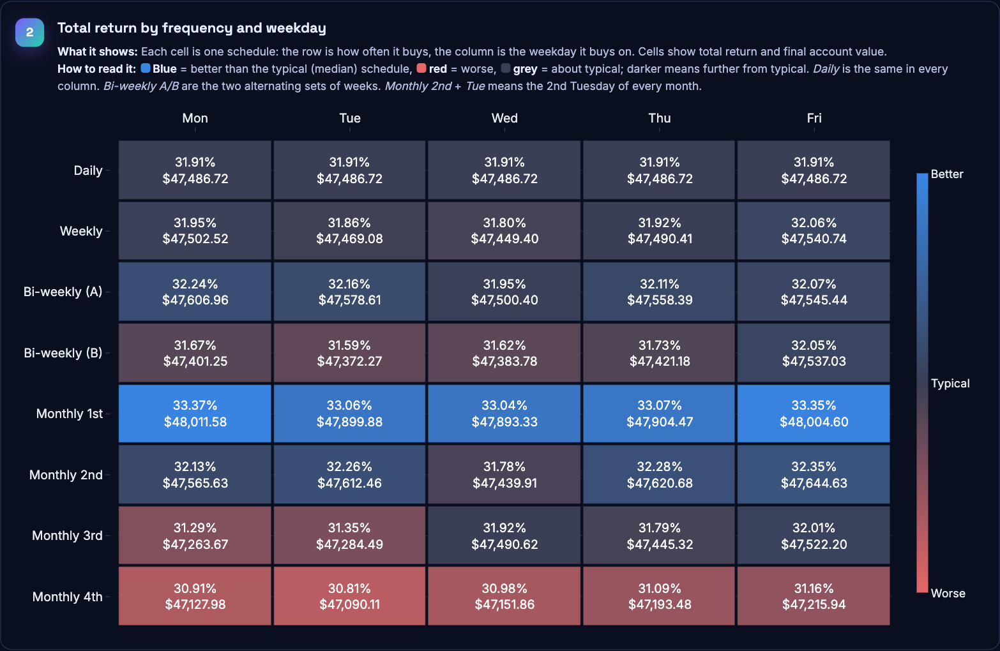

**This is the best chart to start with.** Each cell is one schedule. Its row is how often it buys, and its
column is the weekday it buys on. Each cell shows the total return and the final account value.

- **Blue** = did better than the typical (median) schedule.
- **Red** = did worse.
- **Grey** = about typical.
- Darker colours mean further from typical.

How to read the rows:

- **Daily** is the same in every column, because it buys every day.
- **Bi-weekly (A)** and **(B)** are the two alternating sets of weeks. If you buy every other Friday, you are
  either on week set A or week set B.
- **Monthly 2nd** in the **Tue** column means "the 2nd Tuesday of every month".

In the example, the **Monthly 1st** row is clearly blue (buying in the first week of the month did best)
and the **Monthly 4th** row is clearly red (buying in the last week did worst).

#### Chart 3: Monthly on a fixed date

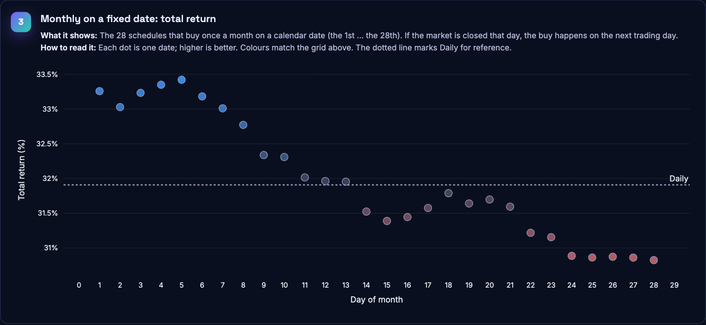

The 28 schedules that buy once a month on a calendar date, from the 1st to the 28th. If the market is
closed that day, the buy happens on the next trading day. The dotted line shows **Daily** for comparison.

In the example, there is a clear downward slope: the earlier in the month you bought, the better you did.

#### Chart 4: Total return over time

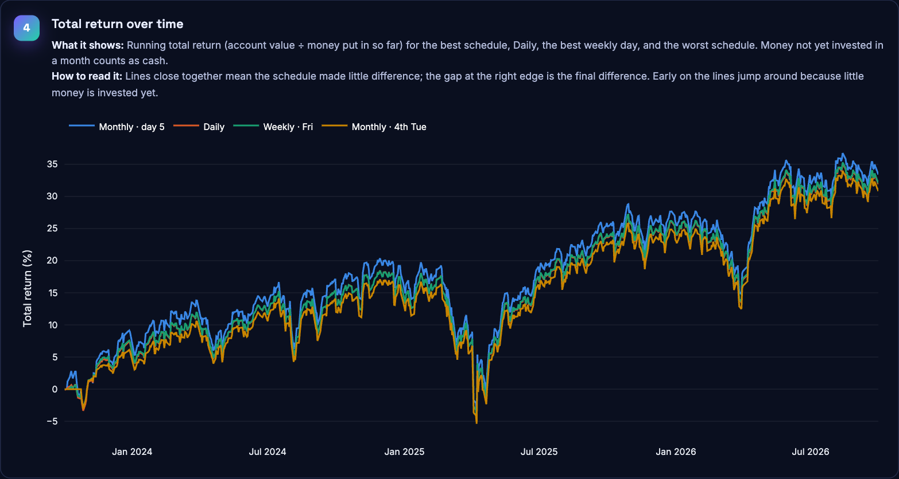

How your return grew month by month for four schedules: the best one, Daily, the best weekly day, and the
worst one. Lines that stay close together mean the schedule made little difference. The gap at the right
edge is the final difference.

#### Full results table

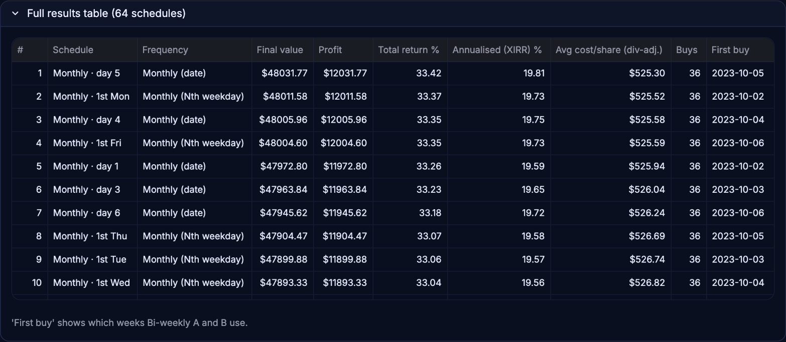

Open **Full results table** below the charts to see all 64 schedules ranked, with:

| Column | Meaning |
|---|---|
| **Final value** | What the account was worth at the end. |
| **Profit** | Final value minus the money you put in. |
| **Total return %** | Profit as a percentage of the money you put in. |
| **Annualised (XIRR) %** | The yearly return, accounting for *when* each dollar went in. |
| **Avg cost/share** | The average price paid per share (using dividend-adjusted prices). |
| **Buys** | How many purchases the schedule made. |
| **First buy** | The date of the first purchase. For bi-weekly schedules, this tells you which weeks A and B are. |

### 3. Rolling windows tab

A single period can be **luck**. Maybe the market happened to dip on the 4th Tuesday a few times. This tab
answers the more useful question: *"Which schedule does well **consistently**?"*

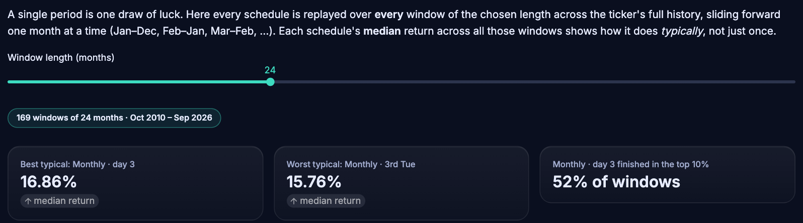

**How it works.** Choose a **window length** (for example 24 months). The app then runs every schedule over
every 24-month stretch in the ticker's full history, sliding forward one month at a time:
Oct 2010 – Sep 2012, Nov 2010 – Oct 2012, and so on. For VOO that is **169 windows**.

For each schedule it then reports the **median** return across all those windows, which is what you
would typically have got.

The summary tiles show the best and worst typical schedule, and **how often the best one finished in the
top 10%** of all schedules. In the example, buying monthly on the 3rd finished in the top 10% in
**52% of windows**.

#### The rolling heatmap

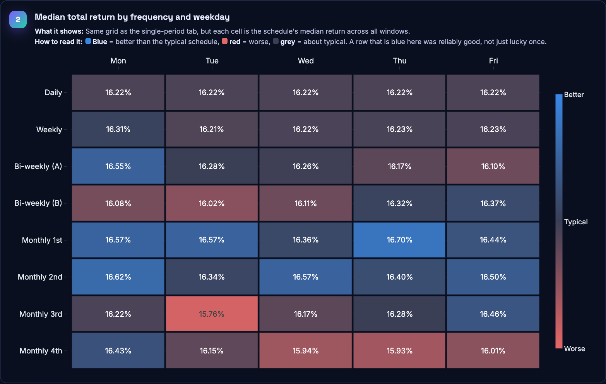

The same grid as the Single period tab, but each cell is now the **median** return across all windows. A
row that is blue here was **reliably** good, not just lucky once.

Compare it with the single-period heatmap above. The first two weeks of the month (Monthly 1st and 2nd)
are mostly blue in both, so that pattern holds up. Other cells flip: **Monthly 4th Mon** was red over the
single period, but across all windows it was better than typical. Also notice how small the spread is:
every schedule's median return falls between about 15.8% and 16.7%.

**Base your decision on this tab rather than the Single period tab.**

#### Advantage over investing daily

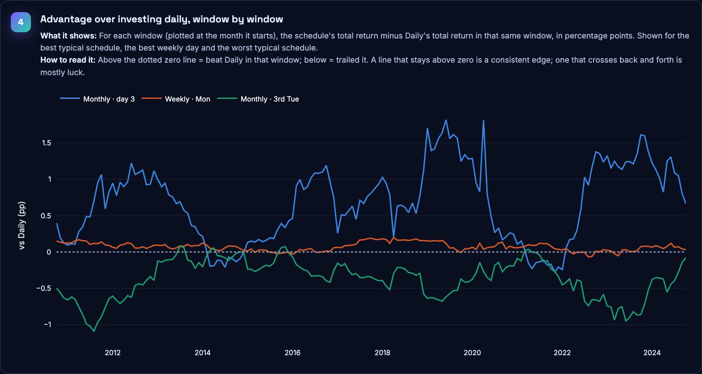

For each window, this shows how many percentage points a schedule beat (or trailed) **Daily** in that
same window. The dotted line at zero means "same as Daily".

- A line that **stays above zero** is a consistent edge.
- A line that **keeps crossing zero** is mostly luck.

In the example, buying monthly on the 3rd (blue) beat Daily in most windows, while buying on the 3rd
Tuesday (green) trailed it in most windows. Weekly on Monday (orange) stayed very close to Daily throughout.

### 4. Portfolio tab

Use this tab to compare several tickers side by side, and to see the combined result if you invest in all
of them.

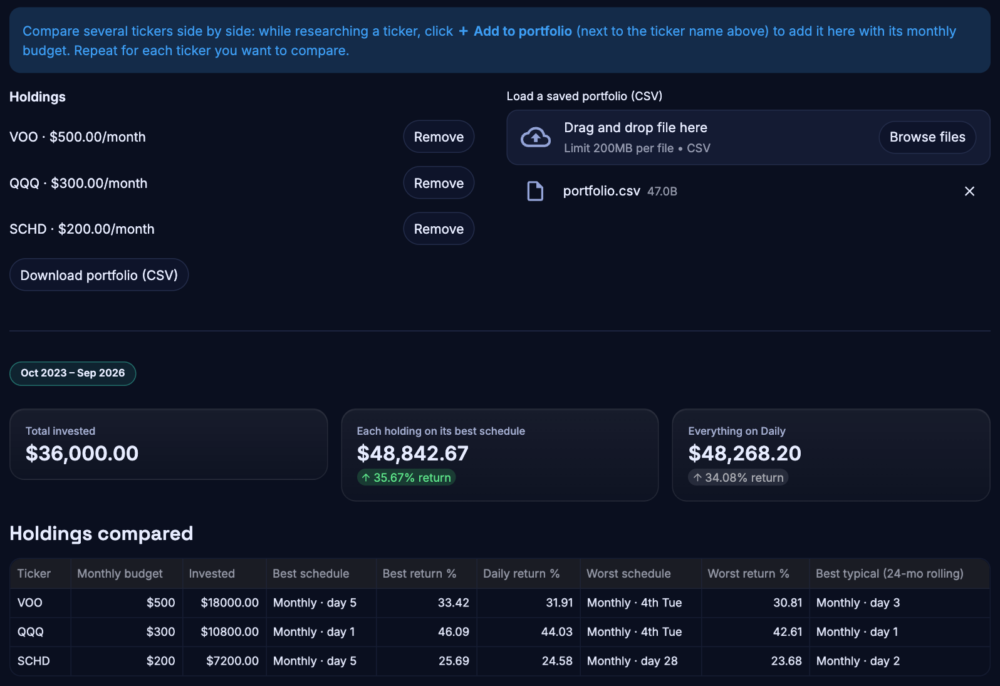

**Adding holdings:**

1. Type a ticker in the sidebar and set its monthly budget.
2. Click **＋ Add to portfolio** next to the ticker name.
3. Repeat for each ticker you want to compare.

You can **download the portfolio as a CSV file** and **load it back** later with the upload box. The
file just has two columns:

```csv
ticker,monthly_budget
VOO,500
QQQ,300
SCHD,200
```

**What you see:**

- **Summary tiles:** total invested, the result if each holding used its own best schedule, and the
  result if everything was bought daily.
- **Holdings compared:** for each ticker, its best, worst and Daily return, plus its best *typical*
  schedule from the rolling-window test.

#### Range of outcomes per holding

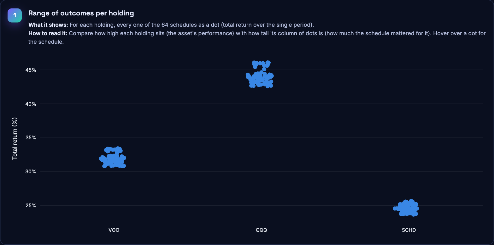

Each column is one holding, and each dot is one of its 64 schedules.

- **How high** a column sits shows how well the asset itself did (QQQ did best here).
- **How tall** the column is shows how much the choice of schedule mattered for that asset.

#### Whole portfolio on one schedule

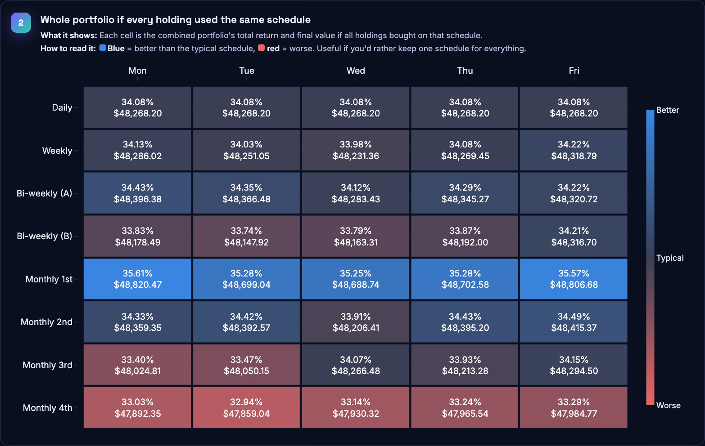

If you'd rather use one schedule for everything, this heatmap shows the combined portfolio's return for
each schedule, using the same blue/red colours as before.

### 5. Read me tab

A short guide built into the app, covering what the tool is for, how to use it and the simulation rules.
It is a good place to send someone who is using the app for the first time.

---

## The 64 schedules

| Frequency | Variations | Count |
|---|---|---|
| Daily | every trading day | 1 |
| Weekly | Mon, Tue, Wed, Thu or Fri | 5 |
| Bi-weekly | each weekday × two alternating week sets (A / B) | 10 |
| Monthly (Nth weekday) | the 1st, 2nd, 3rd or 4th Mon–Fri of the month (e.g. "2nd Tuesday") | 20 |
| Monthly (date) | the 1st … 28th of the month | 28 |

Dates stop at the 28th because every month has one.

---

## How the simulation works

| Rule | Detail |
|---|---|
| Same budget for everyone | Every calendar month gets the same budget, split evenly across that month's scheduled buys (e.g. $1,000 over 4 Tuesdays = $250 each; over 5 Tuesdays = $200 each). |
| Market holidays | A buy scheduled on a closed day executes on the next trading day, as brokers do. It still counts toward the month it was scheduled in. |
| Dividends | Prices are dividend-adjusted, which is equivalent to reinvesting every dividend. |
| Shares | Fractional shares; optional fixed fee per trade; fill at the day's open or close. |
| Valuation | At the last close of the final month. Money for a buy that rolled past that date counts as cash. |

**What it ignores:** taxes, bid/ask spreads, intraday timing and brokerage-specific execution rules.

---

## What you will usually find

- **The differences are small,** often a fraction of a percent to a couple of percent. That is a useful
  answer in itself: if every schedule ends up close, pick whatever is most convenient for you.
- **Buying early in the month tends to win.** With a fixed monthly budget, an early-month schedule gets
  your money into the market sooner. Since markets have risen more often than they have fallen, money
  that is invested sooner has usually grown more. This timing effect is usually bigger than any
  difference between weekdays.
- **Single-period winners are often luck.** If a schedule wins one period but not across rolling
  windows, don't rely on it.

---

## Project layout

| File | Role |
|---|---|
| `app.py` | Streamlit UI |
| `ui.py` | Visual layer: custom CSS, hero banner, section cards |
| `.streamlit/config.toml` | Theme: dark palette, fonts (Inter, Space Grotesk), corner radius |
| `data.py` | Downloads prices via yfinance and caches them in `data/`; falls back to `seed/` |
| `seed/` | Saved prices for popular tickers, used when Yahoo Finance can't be reached |
| `schedule.py` | Turns a schedule (e.g. "bi-weekly Tue, week A") into buy dates |
| `simulate.py` | Single-period runs, value-over-time curves, rolling windows |
| `metrics.py` | Annualised money-weighted return (XIRR) |
| `tests/` | Engine tests on small hand-checked price series, plus price-loading tests: `.venv/bin/python -m pytest tests` |
| `docs/screenshots/` | The images used in this README |

---

## Disclaimer

For education and research only. This is not financial advice, and past performance does not guarantee
future results. Price data comes from Yahoo Finance via the unofficial `yfinance` library and may contain
errors.
